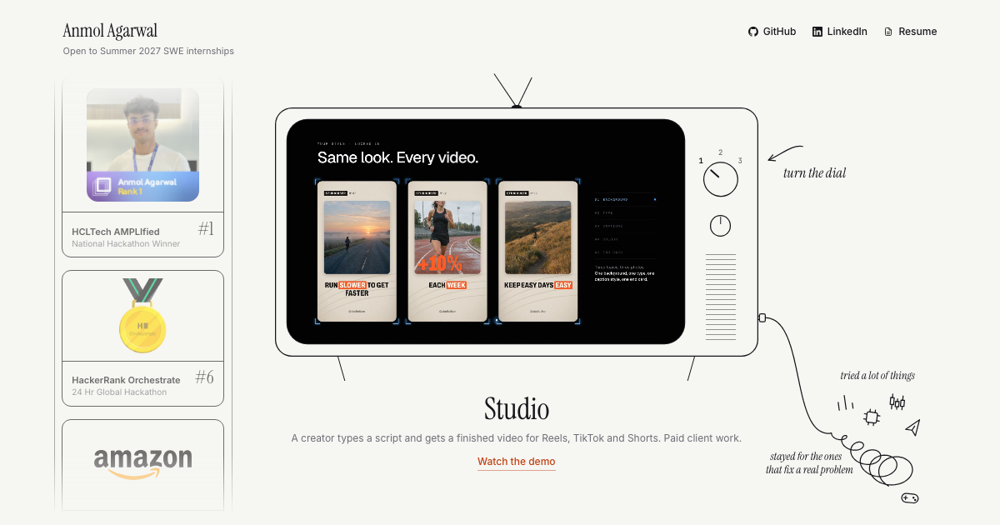

# portfolio

My portfolio. One screen: a line-drawn TV that plays my three projects as channels, with my results on a rail beside it.

Live at **[anmolagarwal.vercel.app](https://anmolagarwal.vercel.app)**



## What's on it

- **Studio**, **Worth** and **Pathwise**, each as a short clip on the TV. The channel changes by itself, or you can turn the dial.
- A rail of results: HCLTech AMPLIfied, HackerRank Orchestrate, the Amazon ML Challenge and Codeforces.
- An opening where the cable draws itself, the set powers on, and a small mascot lights the rail with a torch. Any key or click skips it.
- A phone layout, and a still version for people who have reduced motion turned on.

## Run it

```bash
npm install
npm run dev
```

`npm test` runs the unit tests and `npm run e2e` runs the browser tests.
